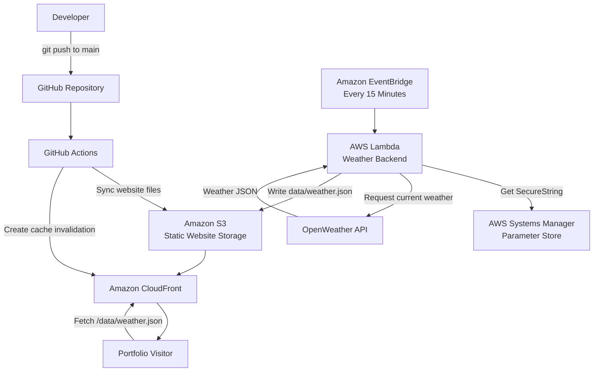
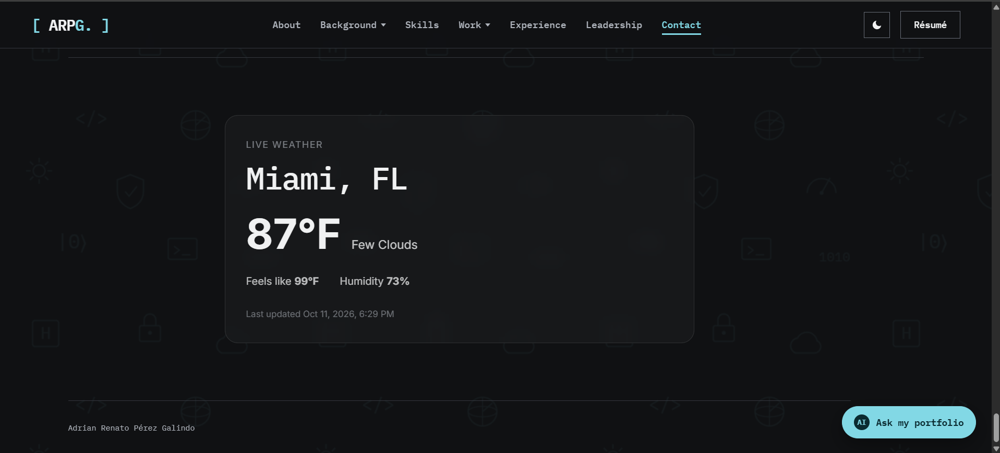
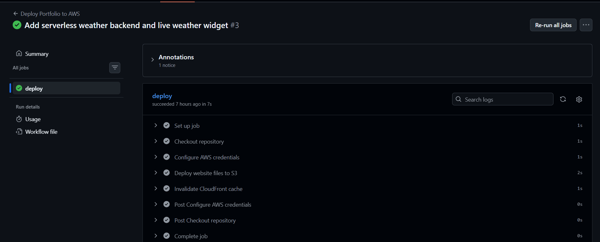
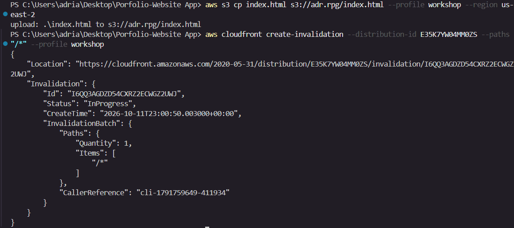
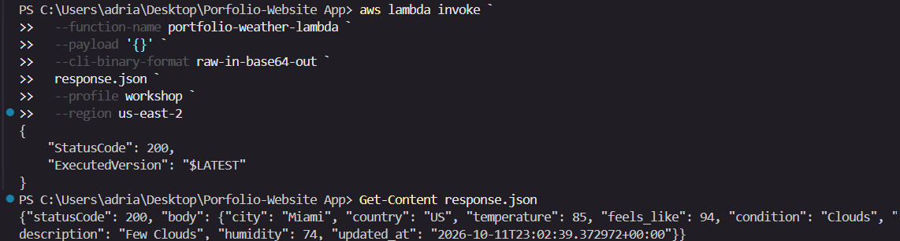
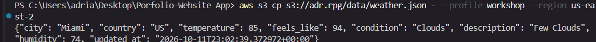
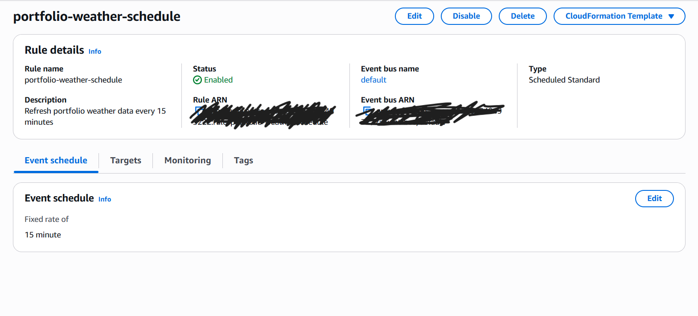

# AWS Serverless Portfolio Website

A cloud-hosted personal portfolio deployed on AWS with Amazon S3 and CloudFront, automated through GitHub Actions CI/CD, and extended with a serverless weather backend using AWS Lambda, Amazon EventBridge, AWS Systems Manager Parameter Store, and the OpenWeather API.

## Live Demo

- **Live Website:** https://d2ghbj4anwhfu9.cloudfront.net
- **GitHub Repository:** https://github.com/AdrianRPG/portfolio-website-aws

## Project Overview

This project transforms my personal portfolio from a locally hosted static website into an automated, cloud-hosted application running on AWS.

The portfolio is delivered through Amazon CloudFront with its website assets stored in Amazon S3. A GitHub Actions CI/CD workflow automatically deploys approved frontend files to S3 and invalidates the CloudFront cache whenever changes are pushed to the `main` branch.

The project was further extended with a serverless backend that provides live weather information. Amazon EventBridge invokes an AWS Lambda function every 15 minutes. The Lambda function securely retrieves an OpenWeather API key from AWS Systems Manager Parameter Store, requests current weather data, processes the API response, and writes the resulting JSON data to Amazon S3. The frontend then retrieves this data through CloudFront and renders it as a live weather widget.

The result is a portfolio that demonstrates not only frontend development, but also cloud deployment, CI/CD automation, serverless computing, secrets management, external API integration, and event-driven architecture.

## Objectives

The primary objectives of this project were to:

- Deploy and deliver a static website using Amazon S3 and Amazon CloudFront.
- Configure AWS CLI workflows for repeatable deployments and CloudFront cache invalidation.
- Automate website deployments using GitHub Actions on every push to the `main` branch.
- Apply IAM least-privilege principles by separating deployment and Lambda execution permissions.
- Protect external API credentials using AWS Systems Manager Parameter Store.
- Build a serverless backend with AWS Lambda and an external weather API.
- Use Amazon EventBridge to automatically refresh dynamic weather data on a schedule.
- Render backend-generated data dynamically in the frontend without exposing API credentials.
- Explore Infrastructure as Code using AWS CloudFormation and a private S3 + CloudFront OAC architecture.

## Architecture

The production architecture combines static website delivery, automated CI/CD, and a scheduled serverless backend.



### Production Data Flow

The application operates through two complementary workflows:

**Website deployment**

`Local development → Git push → GitHub Actions → Amazon S3 → CloudFront invalidation → Live website`

**Dynamic weather updates**

`EventBridge → Lambda → Parameter Store → OpenWeather API → Lambda → S3 weather.json → CloudFront → Live Weather widget`

> **Architecture note:** The current production website uses an Amazon S3 static website endpoint as the CloudFront origin. A separate CloudFormation exercise in this repository explores a more restrictive private-S3 architecture using CloudFront Origin Access Control (OAC), but that stack was not deployed because CloudFormation operations were restricted by the workshop AWS organization's Service Control Policy.

## AWS Services & Technologies

This project integrates multiple AWS services and development tools to support hosting, automation, security, and serverless functionality.

### AWS Services

- **Amazon S3** — Stores the static portfolio assets and generated `data/weather.json` file.
- **Amazon CloudFront** — Delivers the website globally over HTTPS and caches static and dynamic content.
- **AWS Lambda** — Runs the serverless weather backend that retrieves and processes data from the OpenWeather API.
- **Amazon EventBridge** — Invokes the Lambda function automatically every 15 minutes.
- **AWS Systems Manager Parameter Store** — Stores the OpenWeather API key as a `SecureString`.
- **AWS IAM** — Provides scoped permissions for GitHub Actions deployment and Lambda execution.
- **AWS CloudFormation** — Used for Infrastructure as Code practice with a private S3 + CloudFront OAC architecture.
- **AWS CLI** — Used to manage deployments, invoke Lambda, inspect AWS resources, and create CloudFront invalidations.

### Development & Automation Tools

- **GitHub**
- **GitHub Actions**
- **Kiro IDE**
- **Git**
- **OpenWeather API**
- **Python**
- **HTML**
- **CSS**
- **JavaScript**

### Key Technologies Demonstrated

- Cloud hosting and CDN delivery
- CI/CD automation
- Serverless computing
- Event-driven architecture
- Secrets management
- External REST API integration
- IAM least-privilege access control
- Infrastructure as Code
- Static frontend and dynamic backend integration

## Static Website Deployment

The portfolio was deployed as a static website using Amazon S3 for object storage and Amazon CloudFront for content delivery.

The production deployment uses an S3 static website endpoint as the CloudFront origin. This allows the portfolio files to remain organized in a single S3 bucket while CloudFront provides the public HTTPS endpoint used by visitors.

### Deployment Flow

`Local portfolio files → Amazon S3 → Amazon CloudFront → Public HTTPS website`

The main website assets include:

- `index.html`
- `style.css`
- `script.js`
- Optimized image assets
- Resume PDF
- Open Graph image
- Dynamically generated `data/weather.json`

### CloudFront Configuration

CloudFront was configured with:

- `index.html` as the default root object.
- HTTP-to-HTTPS redirection.
- Global content delivery through the CloudFront distribution.
- Cache invalidations after website updates to ensure visitors receive the latest deployed version.

### Manual Update Workflow

Before implementing CI/CD, website updates were deployed manually using the following process:

1. Modify and test the portfolio locally.
2. Upload the updated file to the S3 bucket.
3. Create a CloudFront invalidation for `/*`.
4. Wait for the invalidation to complete.
5. Refresh the live CloudFront website and verify the change.

This manual deployment process was later automated using GitHub Actions.

## AWS CLI Workflow

The AWS CLI was configured locally to support repeatable deployments, resource inspection, and CloudFront cache management directly from the terminal.

A dedicated AWS CLI profile named `workshop` was used for authentication and command execution.

### CLI Verification

The local AWS CLI setup was verified with:

```bash
aws sts get-caller-identity --profile workshop
```

This confirmed that the CLI was authenticated through a non-root AWS role.

### S3 Access Verification

Access to the production website bucket was verified with:

```bash
aws s3 ls s3://adr.rpg --profile workshop --region us-east-2
```

### CLI Deployment

Website updates could be published directly from the terminal. For example:

```bash
aws s3 cp index.html s3://adr.rpg/index.html --profile workshop --region us-east-2
```

### CloudFront Invalidation

After uploading an updated file, CloudFront cache invalidations were created using:

```bash
aws cloudfront create-invalidation \
  --distribution-id YOUR_DISTRIBUTION_ID \
  --paths "/*" \
  --profile workshop
```

The updated website was then verified through the CloudFront HTTPS endpoint after the invalidation completed.

### Result

This workflow demonstrated a repeatable command-line deployment process before the same deployment sequence was later automated through GitHub Actions CI/CD.

## CI/CD with GitHub Actions

The manual deployment process was automated using GitHub Actions so that every push to the `main` branch can publish approved website files to Amazon S3 and invalidate the CloudFront cache automatically.

### Deployment Workflow

`Local change → Git commit → Git push → GitHub Actions → Amazon S3 → CloudFront invalidation → Live website`

The workflow is defined in:

```text
.github/workflows/deploy.yml
```

### Workflow Responsibilities

The GitHub Actions pipeline performs the following steps:

1. Checks out the repository.
2. Configures AWS credentials using GitHub repository secrets.
3. Reads non-sensitive deployment settings from GitHub repository variables.
4. Synchronizes only approved website files to the S3 bucket.
5. Creates a CloudFront invalidation for `/*`.
6. Makes the updated website available through the existing CloudFront distribution.

### Deployment Scope

The S3 synchronization uses an explicit allowlist so that only production website assets are deployed.

Examples include:

- `index.html`
- `style.css`
- `script.js`
- Optimized image assets
- Resume PDF
- Open Graph image

Development files, documentation, backend source code, Infrastructure as Code files, and repository metadata are excluded from the website deployment.

### GitHub Configuration

Sensitive AWS credentials are stored using GitHub Actions repository secrets:

```text
AWS_ACCESS_KEY_ID
AWS_SECRET_ACCESS_KEY
```

Non-sensitive deployment settings are stored as repository variables:

```text
AWS_REGION
S3_BUCKET
CLOUDFRONT_DISTRIBUTION_ID
```

### Validation

The CI/CD pipeline was tested end-to-end by making a visible change to the portfolio, committing it, and pushing it to `main`.

GitHub Actions successfully:

- authenticated with AWS,
- deployed the updated website files to S3,
- created the CloudFront invalidation,
- and delivered the updated content through the live CloudFront website.

This replaced the original manual deployment workflow with an automated deployment pipeline.

## IAM & Security

Security was treated as a core part of the project rather than an afterthought.

### Dedicated Deployment User

A dedicated IAM user named `github-actions-deploy` was created specifically for the GitHub Actions pipeline.

Instead of using an administrator account for automated deployments, this user was assigned a scoped inline policy that allows only the permissions required to:

- list the production S3 bucket,
- upload and delete website objects in that bucket,
- and create CloudFront invalidations for the production distribution.

This follows the principle of least privilege by limiting the CI/CD pipeline to only the AWS resources it needs.

### Lambda Execution Role

The weather backend uses a separate IAM role:

```text
portfolio-weather-lambda-role
```

This role allows AWS Lambda to:

- write execution logs to CloudWatch,
- read the OpenWeather API key from Systems Manager Parameter Store,
- and write only the generated `data/weather.json` object to the production S3 bucket.

### Secrets Management

The OpenWeather API key is not stored in:

- the frontend,
- the Lambda source code,
- the GitHub repository,
- or the GitHub Actions workflow.

Instead, it is stored in AWS Systems Manager Parameter Store as a `SecureString` and retrieved by Lambda at runtime.

### GitHub Secrets

AWS deployment credentials used by GitHub Actions are stored as encrypted repository secrets rather than being committed to source control.

The workflow references:

```text
AWS_ACCESS_KEY_ID
AWS_SECRET_ACCESS_KEY
```

without exposing their values in the repository.

### Repository Safety

Local files containing account-specific AWS information or generated deployment artifacts are excluded through `.gitignore`.

Examples include:

- real IAM policy files containing account-specific ARNs,
- Lambda deployment `.zip` packages,
- temporary Lambda response files,
- environment files,
- private keys,
- and local development artifacts.

Sanitized `.example.json` IAM policy files are included in the repository so the security model can be reviewed without exposing account-specific identifiers.

### Security Improvements for Production

The current project demonstrates secure separation of credentials and permissions, while leaving room for additional hardening in a production environment.

Potential improvements include:

- replacing long-lived GitHub Actions access keys with GitHub OIDC and short-lived AWS credentials,
- migrating the production website from a public S3 static website endpoint to a private S3 origin with CloudFront Origin Access Control,
- adding CloudWatch alarms and security monitoring,
- and managing IAM policies and infrastructure entirely through Infrastructure as Code.

## Serverless Weather Backend

The portfolio includes a serverless weather backend built with AWS Lambda and the OpenWeather API.

The Lambda function is responsible for securely retrieving the API key, requesting current weather data, processing the response, and publishing a simplified JSON file that the frontend can consume.

The backend source code is located at:

```text
backend/weather_lambda/lambda_function.py
```

### Backend Workflow

`Lambda → Parameter Store → OpenWeather API → Processed weather data → Amazon S3`

When invoked, the Lambda function:

1. Retrieves the OpenWeather API key from AWS Systems Manager Parameter Store using `ssm:GetParameter`.
2. Sends a request to the OpenWeather Current Weather API.
3. Extracts only the fields needed by the portfolio.
4. Generates a simplified weather response.
5. Writes the result to:

```text
data/weather.json
```

inside the production S3 bucket.

### Generated Data

The generated JSON includes fields such as:

```json
{
  "city": "Miami",
  "country": "US",
  "temperature": 90,
  "feels_like": 103,
  "condition": "Clear",
  "description": "Clear Sky",
  "humidity": 70,
  "updated_at": "2026-10-11T17:29:24.869643+00:00"
}
```

This approach keeps the external API key on the backend while exposing only the processed, non-sensitive weather data required by the frontend.

### Serverless Design

The backend does not require a continuously running server.

AWS Lambda executes only when triggered, making the weather integration:

- serverless,
- event-driven,
- lightweight,
- and suitable for a low-traffic portfolio application.

The Lambda function was tested manually through the AWS CLI before being connected to Amazon EventBridge for scheduled execution.

## EventBridge Automation

Amazon EventBridge was used to automate the weather backend so that the portfolio receives updated weather data without requiring manual Lambda invocations.

A scheduled EventBridge rule named:

```text
portfolio-weather-schedule
```

was configured with the following schedule:

```text
rate(15 minutes)
```

### Scheduled Update Flow

`EventBridge → AWS Lambda → OpenWeather API → Amazon S3 → CloudFront → Live Weather Widget`

Every 15 minutes, EventBridge invokes the `portfolio-weather-lambda` function. The Lambda function then:

1. Retrieves the OpenWeather API key from Systems Manager Parameter Store.
2. Requests the latest weather data.
3. Processes the API response.
4. Rewrites `data/weather.json` in the S3 bucket.
5. Makes the updated data available to the frontend through CloudFront.

### Lambda Invocation Permission

The Lambda resource-based policy allows only the configured EventBridge rule to invoke the weather function.

This creates a clear event-driven relationship between:

```text
portfolio-weather-schedule
        ↓
portfolio-weather-lambda
```

### Validation

The scheduled workflow was validated by comparing the `updated_at` field in `data/weather.json` before and after an EventBridge execution window.

The weather data changed automatically without manually invoking Lambda, confirming that the scheduled backend pipeline was working end-to-end.

The updated values were then verified in the production Live Weather widget served through CloudFront.

## Frontend Dynamic Integration

The portfolio frontend retrieves the processed weather data directly from the same CloudFront domain used to serve the website.

The weather widget requests:

```text
/data/weather.json
```

using JavaScript:

```javascript
fetch("/data/weather.json")
```

Because the JSON file is stored in the same S3 bucket and delivered through the same CloudFront distribution, the frontend can retrieve the weather data without exposing the OpenWeather API key or making direct requests to the external API.

### Weather Widget

The Live Weather component displays:

- city and country,
- current temperature,
- weather description,
- feels-like temperature,
- humidity,
- and the last update timestamp.

The frontend updates these values dynamically after parsing the JSON response generated by Lambda.

### Error Handling

The JavaScript implementation includes fallback behavior for failed requests.

If the weather data cannot be loaded, the widget displays a graceful error state instead of breaking the rest of the portfolio.

### Production Validation

The integration was validated through the live CloudFront website.

After EventBridge triggered the Lambda backend and refreshed `data/weather.json`, the portfolio automatically displayed the updated weather values without requiring changes to the frontend source code.

This demonstrated a complete connection between the serverless AWS backend and the static website frontend.

## Infrastructure as Code Practice

As part of the project, I also explored Infrastructure as Code using AWS CloudFormation.

A separate practice template was created at:

```text
aws-practice/template.yaml
```

The template defines a more restrictive architecture than the current production deployment.

### CloudFormation Architecture

The practice stack includes:

- a private Amazon S3 bucket,
- Amazon CloudFront,
- CloudFront Origin Access Control (OAC),
- an S3 bucket policy scoped to the CloudFront distribution,
- HTTPS delivery,
- and `index.html` as the default root object.

The intended architecture is:

```text
Visitor
   ↓
CloudFront
   ↓
Origin Access Control
   ↓
Private S3 Bucket
```

Unlike the production website, which currently uses an S3 static website endpoint, this design keeps the S3 bucket private and allows CloudFront to access it through signed requests.

### Local Validation

The template was validated locally for:

- YAML syntax,
- CloudFormation structure,
- intrinsic functions such as `!Ref`, `!Sub`, and `!GetAtt`,
- cross-resource references,
- S3 public access blocking,
- OAC configuration,
- CloudFront-to-S3 permissions,
- HTTPS redirection,
- and template outputs.

The local validation completed without structural errors.

### Deployment Limitation

The CloudFormation stack was not deployed.

The workshop AWS environment applies an AWS Organizations Service Control Policy (SCP) that explicitly denied CloudFormation operations including:

```text
cloudformation:ValidateTemplate
cloudformation:DescribeStacks
```

Because an explicit SCP deny cannot be overridden by account-level IAM permissions, the CloudFormation deployment was intentionally stopped rather than attempting to bypass the organization-level restriction.

### Result

Although the practice stack was not deployed, this exercise demonstrated:

- CloudFormation template design,
- private S3 + CloudFront OAC architecture,
- AWS resource dependency planning,
- policy-based access control,
- and the distinction between locally validated Infrastructure as Code and infrastructure that has actually been deployed.

## Project Structure

```text
portfolio-website-aws/
├── .github/
│   └── workflows/
│       └── deploy.yml
│
├── aws-practice/
│   ├── template.yaml
│   ├── github-actions-policy.example.json
│   ├── lambda-runtime-policy.example.json
│   └── lambda-trust-policy.json
│
├── backend/
│   └── weather_lambda/
│       └── lambda_function.py
│
├── index.html
├── style.css
├── script.js
├── adrian-perez-galindo-resume.pdf
├── og-image.png
├── headshot.webp
├── headshot-opt.jpg
├── about.webp
├── about.jpg
├── fiu.webp
├── fiu.jpg
├── shellhacks.webp
├── shellhacks.jpg
├── .gitignore
└── README.md
```

### Directory Purpose

- **`.github/workflows/`** — Contains the GitHub Actions CI/CD deployment workflow.
- **`aws-practice/`** — Contains CloudFormation and sanitized IAM policy examples used for AWS infrastructure and security practice.
- **`backend/weather_lambda/`** — Contains the Python source code for the serverless weather backend.
- **Root website files** — Contain the production frontend assets deployed to Amazon S3 and delivered through CloudFront.

Generated deployment artifacts, temporary response files, secrets, and account-specific IAM policy files are intentionally excluded from the public repository through `.gitignore`.

## Implementation Evidence

The following screenshots document key stages of the completed AWS deployment and automation workflow.

### Live Portfolio

The production portfolio is delivered through Amazon CloudFront over HTTPS and includes the dynamically updated Live Weather component.



### GitHub Actions CI/CD

The deployment workflow runs automatically after pushes to the `main` branch and completes the S3 deployment and CloudFront invalidation process.



### AWS CLI Deployment

AWS CLI was used to validate access, upload website updates to Amazon S3, and create CloudFront cache invalidations before the deployment process was automated.



### Lambda Weather Backend

The weather Lambda function was tested successfully and returned processed weather data retrieved from the OpenWeather API.



### Generated Weather Data

The Lambda backend writes the processed weather response to `data/weather.json` in Amazon S3, where it becomes available through CloudFront.



### EventBridge Automation

Amazon EventBridge invokes the weather Lambda function every 15 minutes, allowing the portfolio weather data to refresh automatically without manual execution.



## Results

The completed project evolved from a static personal portfolio into a cloud-hosted, automated, and serverless AWS application.

### Deployment Results

- The portfolio is publicly available through Amazon CloudFront over HTTPS.
- Static website assets are stored in Amazon S3 and delivered through the CloudFront distribution.
- Website updates can be deployed manually through the AWS CLI or automatically through GitHub Actions.
- CloudFront cache invalidation is automated as part of the CI/CD pipeline.

### CI/CD Results

The GitHub Actions workflow successfully demonstrated:

- automatic execution on pushes to the `main` branch,
- AWS authentication using repository secrets,
- controlled synchronization of approved frontend assets to S3,
- automatic CloudFront invalidation,
- and delivery of updated website content without manual AWS Console interaction.

### Serverless Backend Results

The weather backend successfully:

- retrieved the OpenWeather API key from Systems Manager Parameter Store,
- called the OpenWeather API from AWS Lambda,
- processed the external API response,
- generated `data/weather.json`,
- stored the generated data in Amazon S3,
- and exposed the processed data to the frontend through CloudFront.

### Event-Driven Automation Results

Amazon EventBridge successfully invoked the Lambda backend on a 15-minute schedule.

The scheduled automation was verified by observing changes in:

- the `updated_at` timestamp,
- temperature,
- humidity,
- and other weather values

without manually invoking the Lambda function.

The updated data was subsequently rendered in the production Live Weather widget.

### Final Outcome

The final system demonstrates an end-to-end cloud workflow:

`Source Control → CI/CD → Cloud Hosting → Serverless Backend → Scheduled Automation → Dynamic Frontend`

This project combines frontend development with AWS deployment, IAM security, automation, serverless computing, external API integration, and event-driven architecture in a single production-facing portfolio application.

## Skills Demonstrated

This project demonstrates practical experience across cloud infrastructure, automation, security, backend development, and frontend integration.

### Cloud & AWS

- Amazon S3 static website hosting
- Amazon CloudFront content delivery and cache invalidation
- AWS Lambda serverless computing
- Amazon EventBridge scheduled automation
- AWS Systems Manager Parameter Store
- AWS IAM users, roles, and scoped policies
- AWS CLI workflows
- AWS CloudFormation template design

### DevOps & Automation

- Git and GitHub version control
- GitHub Actions CI/CD
- Automated deployment pipelines
- Environment-specific configuration through GitHub Secrets and Variables
- Deployment allowlists and controlled artifact publishing
- CloudFront cache invalidation automation

### Security

- IAM least-privilege design
- Separation of deployment and execution permissions
- Secure secret storage using Parameter Store
- Repository secret management
- Sanitized example policies for public documentation
- Exclusion of sensitive and generated files through `.gitignore`

### Backend & Integration

- Python-based AWS Lambda development
- External REST API integration
- JSON response processing
- Serverless data generation
- Scheduled backend execution
- Writing generated application data to Amazon S3

### Frontend

- HTML
- CSS
- JavaScript
- Dynamic data rendering with `fetch()`
- Graceful client-side error handling
- Responsive UI integration for live backend-generated data

### Architecture & Engineering

- Static and dynamic cloud architecture
- Event-driven systems
- CDN-based content delivery
- Serverless application design
- Infrastructure as Code concepts
- Resource dependency planning
- End-to-end deployment and validation

## Workshop Context

This project originated from the **Build & Host Your Website on AWS** workshop organized by the **AWS Student Builder Group at Florida International University (FIU)**.

The workshop focused on deploying and hosting a static website on AWS, including Amazon S3, Amazon CloudFront, cache invalidation, AWS CLI usage, and optional Infrastructure as Code practice.

Rather than using the workshop starter template, I applied the deployment workflow to my existing personal portfolio and then extended the project beyond the core workshop requirements.

### Extensions Beyond the Core Workshop

After completing the initial AWS hosting workflow, I implemented several next-level enhancements:

- AWS CLI-based deployment and CloudFront invalidation
- GitHub Actions CI/CD for automatic deployments on pushes to `main`
- A dedicated IAM user for deployment automation
- Least-privilege IAM policies
- A serverless AWS Lambda backend
- Secure API key storage with Systems Manager Parameter Store
- OpenWeather API integration
- Amazon EventBridge scheduled execution
- A dynamic Live Weather component rendered in the production frontend
- CloudFormation Infrastructure as Code practice

These additions transformed the project from a static hosting exercise into a broader cloud engineering project that combines deployment automation, serverless computing, security, event-driven architecture, and frontend-backend integration.

## Source & Attribution

This project was developed as an extension of the **Build & Host Your Website on AWS** workshop organized by the **AWS Student Builder Group at Florida International University (FIU)**.

The original workshop materials provided guidance on:

- hosting a static website with Amazon S3,
- delivering content through Amazon CloudFront,
- managing CloudFront cache invalidations,
- using the AWS CLI,
- and exploring Infrastructure as Code with AWS CloudFormation.

The website itself is my personal portfolio and was not built from the workshop starter template.

The project was independently extended after the workshop with:

- GitHub Actions CI/CD,
- dedicated IAM deployment permissions,
- AWS Lambda,
- AWS Systems Manager Parameter Store,
- Amazon EventBridge,
- OpenWeather API integration,
- dynamic frontend weather rendering,
- and additional security and automation practices.

### External Services

- **AWS** — Cloud infrastructure, hosting, automation, security, and serverless services.
- **OpenWeather** — Current weather data used by the Live Weather backend integration.
- **GitHub** — Source control and GitHub Actions CI/CD.

No workshop slide decks or proprietary instructional materials are included in this repository.

## Security Notes

Security was treated as a core part of the project rather than an afterthought.

Key practices implemented include:

- AWS credentials and API keys are not stored in the repository.
- The OpenWeather API key is stored securely in AWS Systems Manager Parameter Store as a `SecureString`.
- GitHub Actions uses repository secrets for AWS authentication.
- A dedicated IAM user, `github-actions-deploy`, is used for CI/CD instead of reusing a personal or administrative identity.
- The Lambda function uses a separate execution role with only the permissions required to read the weather parameter, write `data/weather.json`, and create logs.
- Account-specific IAM policy files are excluded from Git and replaced with sanitized `.example.json` versions for public documentation.
- Generated deployment artifacts and temporary files are excluded through `.gitignore`.
- AWS account IDs, secret keys, API keys, and temporary credentials are not intentionally exposed in repository documentation or screenshots.

### Current Security Limitation

The production website currently uses an Amazon S3 static website endpoint as the CloudFront origin, which requires the website content to remain publicly accessible from S3.

A more secure production architecture would use:

`CloudFront → Private S3 Bucket → Origin Access Control (OAC)`

This private-origin design was explored in the CloudFormation exercise, but deployment was not possible in the workshop environment because organization-level Service Control Policies restricted the required CloudFormation operations.

### Future Authentication Improvement

GitHub Actions authentication through OpenID Connect (OIDC) was also explored as a more secure alternative to long-lived AWS access keys. However, the workshop AWS environment blocked the required IAM OIDC operations through an organization-level Service Control Policy.

For a production environment without these restrictions, OIDC-based short-lived credentials would be preferred.

## Conclusion

This project demonstrates the progression of a personal portfolio from a static website into a cloud-hosted and automated application built with AWS.

The final implementation combines:

- Amazon S3 and CloudFront for website hosting and delivery,
- AWS CLI workflows for manual deployment,
- GitHub Actions for CI/CD automation,
- IAM for deployment and runtime permission separation,
- AWS Lambda for serverless backend processing,
- Systems Manager Parameter Store for secure API key storage,
- Amazon EventBridge for scheduled execution,
- OpenWeather for external data integration,
- and JavaScript for dynamic frontend rendering.

Beyond successfully deploying the portfolio, the project provided practical experience with cloud architecture, serverless development, security controls, automation, CI/CD, external APIs, and event-driven systems.

The resulting website is not only a portfolio for presenting projects and experience, but also a portfolio project itself that demonstrates hands-on AWS and cloud engineering skills.